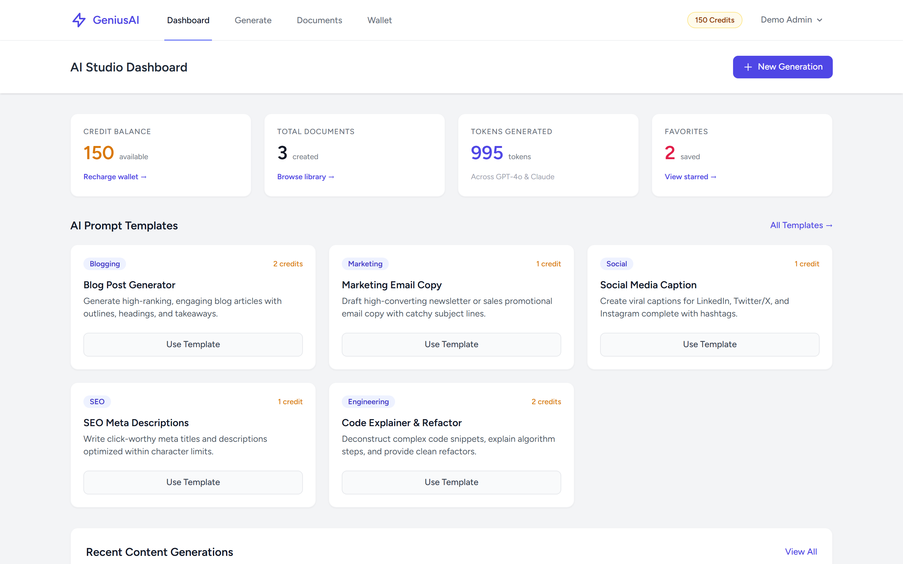
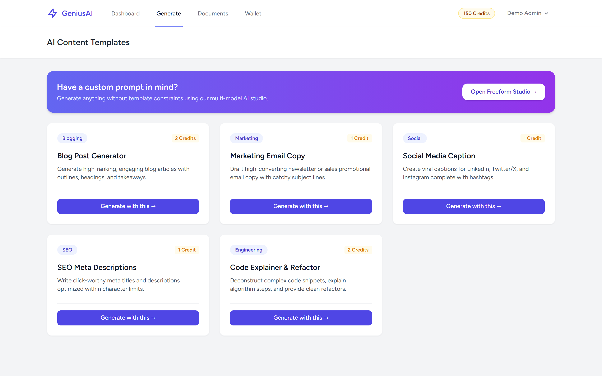
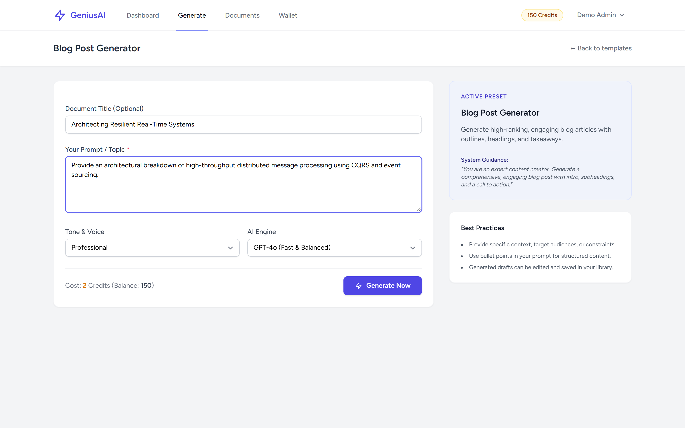
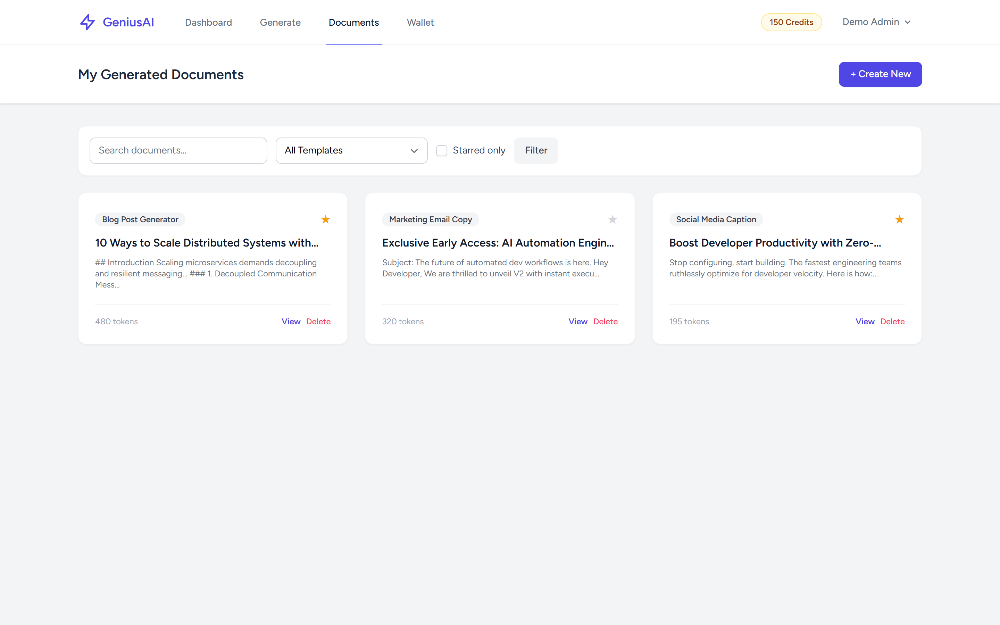

# AI Content Generator (Laravel 12 / Breeze / Tailwind / SQLite)

A modern, multi-model AI content generation studio built with Laravel, Tailwind CSS, and Blade. Features prompt templates, tone adaptation, token estimation, and an atomic credit wallet.

## Features

- **Multi-Model Support**: Pre-configured support for GPT-4o, Claude 3.5 Sonnet, and Mistral Large.
- **Preset Prompt Library**: Blog posts, marketing email copy, social media captions, SEO meta descriptions, and code explainers.
- **Credit Wallet & Ledger**: Atomic deduction and transaction recording in database transactions with wallet top-up packages.
- **Document Management**: Markdown viewer & editor, copy-to-clipboard, starring/favorites, and multi-parameter filtering.
- **Responsive Interface**: Tailwind CSS navigation with live balance counters and mobile menus.

## Screenshots

| Tampilan | Preview |
|---|---|
| **Dashboard Studio AI**<br>Ringkasan saldo kredit, total dokumen dibuat, dan jalan pintas template cepat |  |
| **Katalog Template Pembuatan Konten**<br>Pilihan template terstruktur untuk blog, email, media sosial, dan kode |  |
| **Editor Prompt & Generator AI**<br>Formulir penyesuaian instruksi prompt, nada bahasa, dan pemilihan model LLM |  |
| **Pustaka Dokumen Tersimpan**<br>Manajemen dokumen konten hasil generasi, jumlah token, dan penanda favorit |  |

---

## Tech Stack

- **Backend**: Laravel 12.x (PHP 8.3+)
- **Authentication**: Laravel Breeze
- **Database**: SQLite (local & testing), PostgreSQL ready
- **Frontend**: Blade, Tailwind CSS, Vite

## Setup & Testing

```bash
cp .env.example .env
php artisan key:generate
touch database/database.sqlite
php artisan migrate --seed
npm install
npm run build
php artisan test
```
